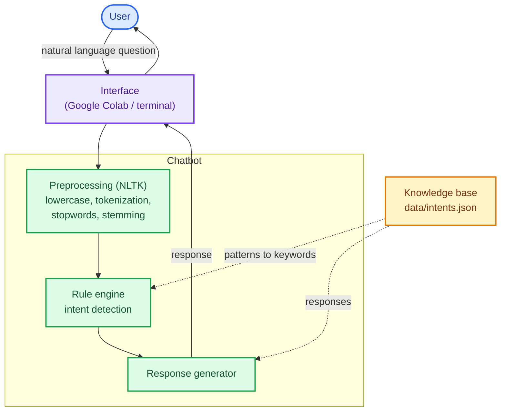
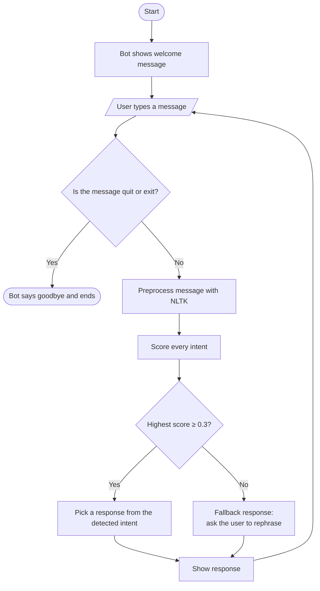

# HPC Cluster Assistant with NLTK

[](https://colab.research.google.com/github/Japh-ai/HPC-chatbot-nltk/blob/main/notebooks/hpc_chatbot.ipynb)

**This is an academic project.**

A rule-based chatbot that answers frequently asked questions from users of a university HPC (High Performance Computing) cluster, built with Python and NLTK.

## Problem

New HPC cluster users (students, researchers, professors) keep asking the same basic questions: how to connect, submit a SLURM job, check its status or load software. They wait hours or days for answers from a small support team, which spends its time on repetitive tickets.

## Objective

Build a rule-based chatbot that answers these frequent questions instantly, so users get help 24/7 and the support team can focus on complex problems.

## Scope

**Covers:** greetings and goodbyes, connecting to the cluster (SSH), submitting, checking and cancelling SLURM jobs, job submission errors, listing and loading software modules, and contacting support.

**Out of scope:** running commands, accessing real user accounts or job data, and diagnosing complex errors. English only.

## How it works

### Architecture



### Conversation flow



### Knowledge base

Each intent in [`data/intents.json`](data/intents.json) has:

- **tag**: the intent's internal name (e.g. `submit_job`)
- **patterns**: example phrases a user might type
- **responses**: what the bot replies

An intent's score is the share of the message's words that match its keywords. The highest-scoring intent wins if it reaches the threshold (0.3); otherwise the bot asks the user to rephrase.

## Project structure

```
HPC-chatbot-nltk/
├── data/intents.json            # knowledge base (11 intents)
├── notebooks/hpc_chatbot.ipynb  # Colab notebook: code, tests and analysis
├── architecture.mmd             # architecture diagram (Mermaid source)
├── main.py                      # command-line version of the chatbot
└── requirements.txt
```

## Run it

**Google Colab:** click the *Open in Colab* badge above, then *Runtime → Run all*.

**Locally** (Python 3.10+):

```bash
pip install -r requirements.txt
python main.py
```

Type your questions, and `quit` to exit.

```
You: how do I submit a job?
Bot: Create a SLURM script and submit it with: sbatch my_script.sh
```

## Test results

10 test conversations (34 messages) covering every intent, plus synonyms, typos and out-of-scope questions: **28/34 correct (82%)**. The bot failed on synonyms (*kill*, *view*), typos (*helo*) and messages where several intents share keywords (*job*, *run*).

The full test run, the analysis of the limitations and the planned improvements are in the [notebook](notebooks/hpc_chatbot.ipynb).
